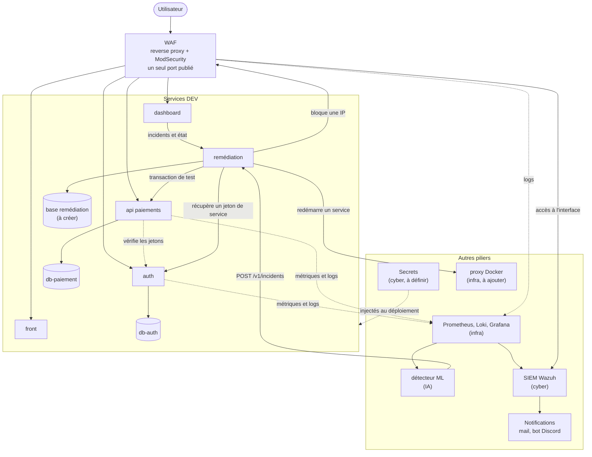
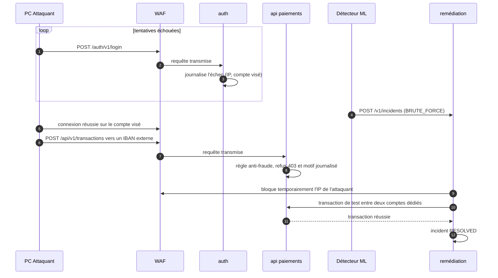

# Architecture applicative

## 1. Ce qu'on code

Cinq services et un package partagé :

| Service       | Dossier                | Rôle                                                                                                                                        |
| ------------- | ---------------------- | ------------------------------------------------------------------------------------------------------------------------------------------- |
| auth          | `services/auth`        | Comptes utilisateurs, connexion, émission des jetons JWT, jetons pour les services, journal des échecs de connexion.                        |
| api paiements | `services/api`         | Comptes, virements simulés (internes ou vers un IBAN externe), protection contre les doublons, règle anti-fraude, état de santé, métriques. |
| remédiation   | `services/remediation` | Reçoit les incidents, exécute le bon playbook, vérifie la reprise par une transaction de test, garde l'historique.                          |
| front         | `services/front`       | Interface client : connexion, virement, historique.                                                                                         |
| dashboard     | `services/dashboard`   | Supervision pour le jury : état des services, incidents, avancement de la reprise.                                                          |
| shared        | `packages/shared`      | Schémas, types, middleware JWT, logger, client HTTP typé, utilisés par les services.                                                        |

Chaque service tourne dans son propre conteneur, avec sa propre base PostgreSQL 16 dans un conteneur séparé (`db-auth`, `db-paiement`, et une base pour la remédiation à créer). Aucun service n'a accès à la base d'un autre. La base de la remédiation conserve l'historique des incidents si le moteur redémarre.

## 2. Vue d'ensemble

Traits pleins : appels directs. Pointillés : vérification ou observation.

### Réseau du labo

- Point d'accès mobile Windows `RESILIENCE-G3`, réseau `192.168.137.0/24`.
- PC Hôte en `192.168.137.1`, qui fait tourner tous les conteneurs.
- Depuis le réseau, on ne doit accéder qu'au WAF, sur un port dédié. Il redirige vers les conteneurs applicatifs. Les bases, le proxy Docker et les secrets ne sont pas publiés.
- Le compose de l'infra sépare quatre réseaux Docker : `frontend` (seul le WAF), `backend` (les applications entre elles), `data` (applications et bases), `monitoring` (Prometheus, Loki, Grafana, Wazuh).
- État actuel du compose : le WAF écoute sur le port 80, et Prometheus (9090), Grafana (3000) et Wazuh (1514, 1515, 55000) sont aussi publiés. À restreindre, voir 9.1.

## 3. Le scénario vu par les services

Le scénario : état normal, brute force sur la connexion, virement frauduleux vers un compte externe, remédiation, retour à la normale.

Ce que chaque service doit faire pour que ça marche :

- **auth** journalise chaque échec de connexion (IP source, compte visé, horodatage) et expose un compteur `auth_login_failures_total`. Le détecteur s'appuie dessus.
- **api paiements** accepte les virements vers un IBAN externe (`to_iban`) et applique une règle anti-fraude : bénéficiaire inconnu ou montant au-dessus du plafond (le signal « compte visé par des échecs de connexion » pourra s'y ajouter). Le refus est un `403` dont le motif est journalisé.
- **remédiation** reçoit l'incident, demande au WAF de bloquer l'IP source pour une durée limitée, puis envoie une transaction de test. Elle ne passe l'incident à `RESOLVED` que si la transaction réussit. Sinon elle essaie une autre action, puis passe en `FAILED`, visible dans le dashboard.
- **dashboard** suit les états `DETECTED`, `REMEDIATING`, `VERIFYING` puis `RESOLVED` en temps réel.

## 4. Remédiation : playbooks

On commence par deux. Les autres viennent si le temps le permet.

| Playbook                    | Quand                              | Action                                 | Vérification                                  |
| --------------------------- | ---------------------------------- | -------------------------------------- | --------------------------------------------- |
| `block_source`              | brute force ou flood depuis une IP | bloque temporairement l'IP dans le WAF | transaction de test réussie                   |
| `restart_service`           | service en erreur ou saturé        | redémarre le conteneur concerné        | `/readyz` puis transaction de test réussie    |
| `restore_db` (plus tard)    | données incohérentes               | restaure le dernier snapshot           | contrôle d'intégrité puis transaction de test |
| `revoke_tokens` (plus tard) | jeton compromis                    | change la clé de signature JWT         | connexion puis transaction de test            |

La transaction de test se fait entre deux comptes créés par un script de seed. Pour l'instant elle appelle l'API directement, sans passer par le WAF : elle prouve que l'API fonctionne, pas que le chemin public est rétabli. Si on la fait passer par le WAF, son IP ne doit pas être celle de l'attaquant (voir les points à décider avec la cyber, section 9).

Le moteur de remédiation ne reçoit d'ordres que du détecteur. Il parle à Docker uniquement via un proxy filtré fourni par l'infra, jamais directement au socket, et il ne touche qu'une liste de conteneurs autorisés. Ce proxy n'est pas encore dans le compose.

## 5. Authentification et droits

- Les utilisateurs reçoivent un JWT signé en RS256, valable 15 minutes, avec le rôle `customer` ou `operator`.
- Les services s'authentifient avec des jetons obtenus auprès de `auth` : `svc:detector`, `svc:dashboard`, `svc:remediation-canary`.
- Seul `svc:detector` peut créer un incident. Seuls `operator` et `svc:dashboard` peuvent les consulter.
- Seul `svc:remediation-canary` peut envoyer une transaction de test (en-tête `X-Synthetic`).

## 6. Choix techniques

- **Services** : Node.js 22, Express 5, TypeScript. `zod` pour valider les entrées, `pino` pour les logs JSON, `prom-client` pour `/metrics`, `jose` pour les JWT.
- **Données** : PostgreSQL 16 et Prisma, un schéma Prisma par service. Les montants sont des entiers en centimes, et un virement s'exécute dans une transaction pour éviter les soldes incohérents.
- **Front et dashboard** : deux applications React avec TypeScript, Vite et Tailwind. Le public et les droits sont différents, donc on ne les mélange pas.
- **Docker** : `dockerode` pour parler au proxy Docker. Images en `node:22-slim`, parce que Prisma se comporte mal sur Alpine.
- **Tests** : Vitest et Supertest, plus un test de bout en bout de la transaction de test.

## 7. Contrats d'API

Chaque service décrit ses routes dans un fichier OpenAPI 3.1, REST et JSON :

| Service       | Fichier                                                        |
| ------------- | -------------------------------------------------------------- |
| auth          | [`api/auth.openapi.yaml`](api/auth.openapi.yaml)               |
| api paiements | [`api/payments.openapi.yaml`](api/payments.openapi.yaml)       |
| remédiation   | [`api/remediation.openapi.yaml`](api/remediation.openapi.yaml) |

Conventions communes : routes sous `/v1`, erreurs au format `application/problem+json`, en-tête `X-Request-Id` propagé, dates en UTC ISO 8601, montants en centimes.

## 8. Interfaces avec les autres piliers

Ce que les autres attendent de nous, et ce qu'on attend d'eux :

| Avec qui | Interface                                                                                                                                                                                                                                                                                 |
| -------- | ----------------------------------------------------------------------------------------------------------------------------------------------------------------------------------------------------------------------------------------------------------------------------------------- |
| IA / ML  | Le détecteur appelle `POST /v1/incidents` sur la remédiation avec un jeton `svc:detector`. Il lit nos métriques et nos logs.                                                                                                                                                              |
| Infra    | Le compose de l'infra (`infra/compose`) lance les services, les bases, le WAF, l'observabilité, Wazuh et un nœud Ansible. Chaque service DEV fournit un `Dockerfile`, `/healthz`, `/metrics` et des logs JSON sur la sortie standard.                                                     |
| Cyber    | Le WAF est un reverse proxy Nginx avec ModSecurity. Il doit offrir une façon de bloquer et débloquer une IP que la remédiation peut appeler (à définir). Le SIEM est Wazuh : il collecte les événements, l'authentification en priorité, et envoie des notifications (mail, bot Discord). |

## 9. À valider

### 9.1 Avec l'équipes

**Déjà répondu**

- Réseau : hotspot `RESILIENCE-G3`, `192.168.137.0/24`, PC Hôte en `192.168.137.1`.
- Seul le WAF doit être joignable depuis le réseau, sur un port dédié (par exemple 2502). Il atteint le front, l'API et le SIEM.
- WAF : reverse proxy avec ModSecurity.
- SIEM : collecte tous types d'événements (système, endpoint, réseau, authentification, cette dernière étant la plus importante) et envoie des notifications par mail ou bot Discord.
- Un compose complet existe dans `infra/compose` (services, bases, WAF, Prometheus, Loki, Promtail, Grafana, Wazuh manager, Ansible).

**Encore ouvert avec la cyber**

- Comment la remédiation bloque une IP dans le WAF (API, fichier rechargé, autre) et pour combien de temps. La question n'a pas encore de réponse.
- Le WAF doit aussi router vers `auth` (le brute force vise la connexion) et vers le dashboard : seuls le front, l'API et le SIEM ont été cités. À confirmer.
- Le SIEM alimente-t-il aussi le détecteur, ou est-il seulement affiché et notifié ?
- Comment les secrets arrivent dans les conteneurs.
- La transaction de test passe-t-elle par le WAF, et avec quelle IP ?

**Encore ouvert avec l'infra** (écarts entre le compose et notre architecture)

- **Ports publiés** : en plus du WAF (port 80 aujourd'hui, 2502 évoqué), Prometheus, Grafana et Wazuh sont publiés sur toutes les interfaces, donc visibles depuis le hotspot. Les lier à `127.0.0.1`, et fixer le port du WAF.
- **Routage du WAF** : l'image `owasp/modsecurity-crs` n'a qu'un seul `BACKEND` (`application`). Il faut des routes vers `auth`, `api`, le dashboard et le SIEM.
- **Remédiation** : elle n'a pas de base, pas d'accès au proxy Docker (absent du compose) et pas de moyen de bloquer une IP dans le WAF.
- **Noms et services manquants** : aligner `application` et `api-paiement` avec `front` et `api`, et ajouter un conteneur `dashboard`.
- **Code et images** : le compose monte `./apps/<nom>` dans une image `node:20-alpine` et lance `npm install` à chaque démarrage. Notre code est dans `services/<nom>`, et on veut un `Dockerfile` par service en `node:22-slim` (Prisma sur Alpine pose problème).
- **Healthchecks** : seules les bases en ont. Les services DEV exposeront `/healthz`.
- **Secrets** : un `.env` obligatoire sans exemple fourni, et aucune intégration de la méthode de secrets choisie.
- **Mémoire** : le README annonce environ 4 Go pour Wazuh et le reste de la stack, à confirmer en regard des 16 Go du PC Hôte.

**IA / Data**

- Sources lues par le détecteur (Prometheus, Loki, le SIEM ?).
- Format de `POST /v1/incidents` : `type`, `score`, `source_ip`, `dedup_key`, preuves. Comment le détecteur obtient son jeton `svc:detector`.
- Logs et métriques d'`auth` dont ils ont besoin pour détecter le brute force.
- Où tourne le détecteur.

**Transformation**

- Ils ont besoin du schéma (section 2) pour l'analyse EBIOS (composants = biens supports) et pour le PCA/PRA. Objectifs de reprise (temps, perte de données acceptable) à connaître.

### 9.2 Avec les coachs

1. **Stack** en Node.js, Express, React et Prisma, avec Python seulement pour le ML.
2. **REST** plutôt que gRPC.
3. **Scénario** : brute force, puis virement frauduleux refusé par l'API, puis blocage de l'IP par le WAF.

## 10. Plan de développement

| Priorité | À livrer                                                                        | C'est fini quand                                                          |
| -------- | ------------------------------------------------------------------------------- | ------------------------------------------------------------------------- |
| 1        | `packages/shared` : types, schémas, middleware JWT, logger                      | les services peuvent l'importer                                           |
| 2        | `auth` : inscription, connexion, JWT, jetons de service, journal des échecs     | un `curl` de connexion marche et chaque échec laisse une trace avec l'IP  |
| 3        | `api` : comptes, virements, règle anti-fraude, `/readyz`, `/metrics`            | une transaction de test réussit et un virement externe suspect est refusé |
| 4        | `remediation` : incidents, deux playbooks, transaction de test, flux temps réel | un incident simulé est résolu avec preuve                                 |
| 5        | `dashboard` : services, incidents, chronologie                                  | on voit l'état avant, pendant et après                                    |
| 6        | `front` : connexion, virement, historique                                       | il génère du trafic normal                                                |
