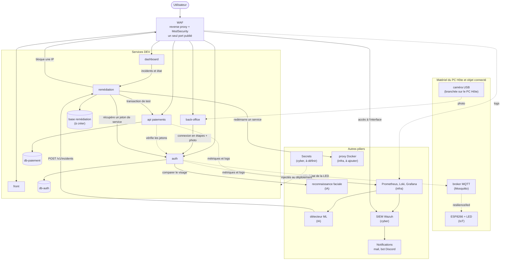
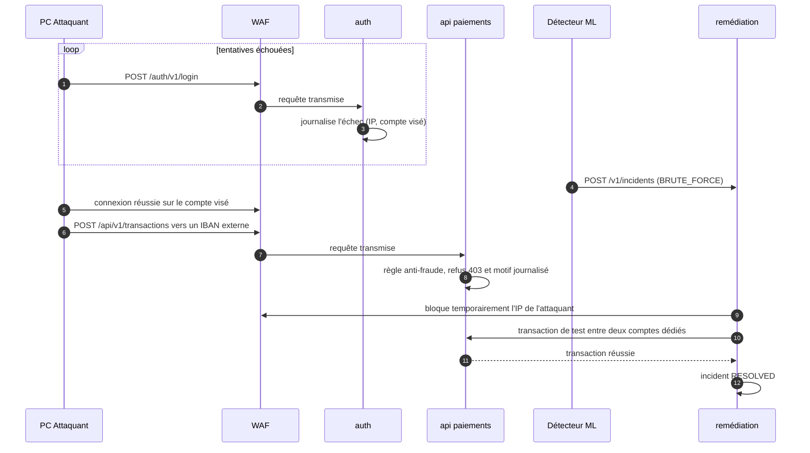
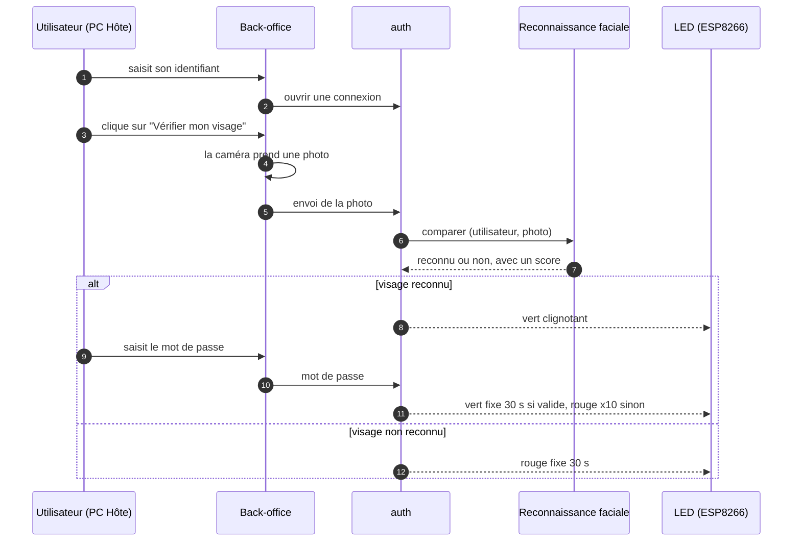
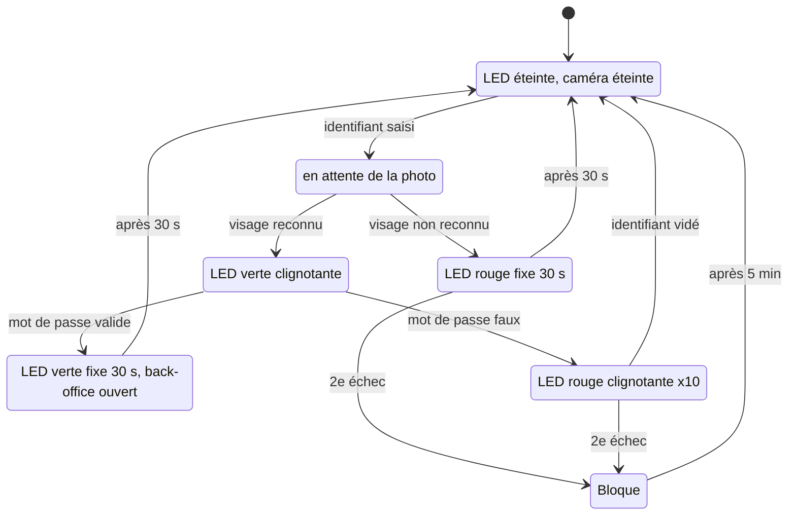

# Architecture applicative

## 1. Ce qu'on code

Six services et un package partagé :

| Service       | Dossier                | Rôle                                                                                                                                                                                                                                                   |
| ------------- | ---------------------- | ------------------------------------------------------------------------------------------------------------------------------------------------------------------------------------------------------------------------------------------------------ |
| auth          | `services/auth`        | Comptes utilisateurs, connexion, émission des jetons JWT, jetons pour les services, journal des échecs de connexion. Connexion du back-office en étapes (identifiant, visage, mot de passe), verrouillage, état de la LED, habilitations (chapitre 4). |
| api paiements | `services/api`         | Comptes, virements simulés (internes ou vers un IBAN externe), protection contre les doublons, règle anti-fraude, état de santé, métriques.                                                                                                            |
| remédiation   | `services/remediation` | Reçoit les incidents, exécute le bon playbook, vérifie la reprise par une transaction de test, garde l'historique.                                                                                                                                     |
| front         | `services/front`       | Interface client : connexion, virement, historique.                                                                                                                                                                                                    |
| dashboard     | `services/dashboard`   | État des services, incidents, avancement de la reprise.                                                                                                                                                                                                |
| back-office   | `services/backoffice`  | Interface d'administration du SI de paiement, distincte du dashboard : connexion renforcée (identifiant, photo du visage, mot de passe) et gestion des habilitations (utilisateurs, rôles, visages).                                                   |
| shared        | `packages/shared`      | Schémas, types, middleware JWT, logger, client HTTP typé, utilisés par les services.                                                                                                                                                                   |

Chaque service tourne dans son propre conteneur, avec sa propre base PostgreSQL 16 dans un conteneur séparé. Aucun service n'a accès à la base d'un autre. La base de la remédiation conserve l'historique des incidents si le moteur redémarre.

## 2. Vue d'ensemble



Traits pleins : appels directs. Pointillés : vérification ou observation.

### Réseau du labo

- Point d'accès mobile Windows `RESILIENCE-G3`, réseau `192.168.137.0/24`. L'ESP8266 s'y connecte en WiFi. La caméra USB est branchée sur le PC Hôte (obligation de la consigne).
- PC Hôte en `192.168.137.1`, qui fait tourner tous les conteneurs.
- Depuis le réseau, on ne doit accéder qu'au WAF, sur un port dédié. Il redirige vers les conteneurs applicatifs. Les bases, le proxy Docker et les secrets ne sont pas publiés.
- Le compose de l'infra sépare quatre réseaux Docker : `frontend` (seul le WAF), `backend` (les applications entre elles), `data` (applications et bases), `monitoring` (Prometheus, Loki, Grafana, Wazuh).
- État actuel du compose : le WAF écoute sur le port 80, et Prometheus (9090), Grafana (3000) et Wazuh (1514, 1515, 55000) sont aussi publiés. À restreindre, voir 10.1.

## 3. Le scénario vu par les services

Le scénario : état normal, brute force sur la connexion, virement frauduleux vers un compte externe, remédiation, retour à la normale.



Ce que chaque service doit faire pour que ça marche :

- **auth** journalise chaque échec de connexion (IP source, compte visé, horodatage) et expose un compteur `auth_login_failures_total`. Le détecteur s'appuie dessus.
- **api paiements** accepte les virements vers un IBAN externe (`to_iban`) et applique une règle anti-fraude : bénéficiaire inconnu ou montant au-dessus du plafond (le signal « compte visé par des échecs de connexion » pourra s'y ajouter). Le refus est un `403` dont le motif est journalisé.
- **remédiation** reçoit l'incident, demande au WAF de bloquer l'IP source pour une durée limitée, puis envoie une transaction de test. Elle ne passe l'incident à `RESOLVED` que si la transaction réussit. Sinon elle essaie une autre action, puis passe en `FAILED`, visible dans le dashboard.
- **dashboard** suit les états `DETECTED`, `REMEDIATING`, `VERIFYING` puis `RESOLVED` en temps réel.

Ce scénario vise la connexion des **clients** (`/v1/login`, pour le front de paiement). Le back-office (l'administration du SI) a sa propre connexion renforcée, décrite au chapitre suivant.

## 4. Connexion du back-office

1. La personne saisit son **identifiant**.
2. Elle clique sur un bouton : la caméra prend **une photo**.
3. L'IA compare la photo au visage enregistré pour cet identifiant.
4. Si c'est le bon visage, elle peut saisir son **mot de passe**. Sinon l'identifiant est vidé et la caméra s'éteint.



`auth` est l'autorité : il garde l'état de la connexion, compte les échecs, applique le verrouillage et décide de l'état de la LED. Le service de reconnaissance faciale ne fait que comparer.

### États et LED



| État de la LED | Ce que fait la LED                      | Quand                                      |
| -------------- | --------------------------------------- | ------------------------------------------ |
| `OFF`          | éteinte                                 | repos, ou fin d'un cycle                   |
| `GREEN_BLINK`  | verte clignotante                       | visage reconnu, en attente du mot de passe |
| `GREEN_SOLID`  | verte fixe 30 s, puis éteinte           | mot de passe valide, back-office ouvert    |
| `RED_BLINK`    | rouge clignotante 10 fois, puis éteinte | mot de passe refusé                        |
| `RED_SOLID`    | rouge fixe 30 s, puis éteinte           | visage non reconnu                         |

**Comment la LED est pilotée.** C'est `auth` qui **publie** l'état sur un broker MQTT (Mosquitto), sur le sujet `resilience/led`, avec exactement les messages que comprend le firmware : `green-blink`, `green-solid`, `red-blink`, `red-solid`, `off`. L'ESP8266 s'y abonne et gère lui-même les durées (30 s, 10 clignotements). En complément, `auth` remet la LED à `off` à l'échéance (pour que son état et celui de la LED restent d'accord), et au démarrage du service.

La LED est un signal, pas une condition d'accès : si le broker est en panne, la connexion fonctionne quand même (l'échec est journalisé et compté), et la publication n'est jamais attendue par la requête HTTP. Il n'y a pas de message conservé (`retain`) : rejouer à la reconnexion de l'ESP un état à durée limitée afficherait une LED fausse.

**Sécurité du canal.** N'importe qui sur le réseau du labo pourrait, sur un broker ouvert, publier `green-solid`. Le broker exige donc un identifiant, et une liste de droits : l'utilisateur `auth` peut **écrire** sur `resilience/led`, l'utilisateur de l'ESP peut seulement **lire**. Vérifié avec un vrai Mosquitto : le client anonyme est refusé, et un message envoyé par l'utilisateur de l'ESP n'est pas retransmis.

### Verrouillage

La consigne dit : « recommencer 1 fois puis être bloqué 5 minutes, etc. ». On l'interprète ainsi :

- un **échec** est un visage non reconnu ou un mot de passe refusé ;
- après **deux échecs** de suite pour un même identifiant, il est bloqué **5 minutes** ;
- chaque nouveau blocage double la durée (5, 10, 20 minutes...), avec un plafond ;
- une connexion réussie remet le compteur à zéro ;
- une connexion en cours expire au bout de quelques minutes si elle n'est pas terminée.

### Ce que chaque composant fait

| Composant              | Rôle                                                                                                                            |
| ---------------------- | ------------------------------------------------------------------------------------------------------------------------------- |
| `auth`                 | État de la connexion, verrouillage, appel à la reconnaissance faciale, publication de l'état de la LED sur MQTT, habilitations. |
| `back-office`          | Page de connexion (identifiant, bouton, capture de la photo), page d'administration des utilisateurs, rôles et visages.         |
| reconnaissance faciale | Compare une photo au visage enregistré. Enregistre et supprime des visages. Garde les gabarits dans un volume non exposé.       |
| ESP8266 + LED          | S'abonne à `resilience/led` et affiche l'état. N'a aucune autre action.                                                         |
| caméra USB             | Branchée sur le PC Hôte. Utilisée pour une photo à la demande.                                                                  |

### Routes proposées (à valider)

| Route                                                             | Rôle de la route                                                                                                  |
| ----------------------------------------------------------------- | ----------------------------------------------------------------------------------------------------------------- |
| `POST /v1/backoffice/login`                                       | Ouvre une connexion à partir de l'identifiant.                                                                    |
| `POST /v1/backoffice/login/:id/face`                              | Envoie la photo (JPEG). Réponse : mot de passe attendu, ou visage refusé.                                         |
| `POST /v1/backoffice/login/:id/password`                          | Envoie le mot de passe. Réponse : jeton, ou refus.                                                                |
| `GET /v1/backoffice/login/:id`                                    | État courant, pour l'interface.                                                                                   |
| `GET /v1/devices/led`                                             | État courant de la LED (lecture, rôles `operator`, `svc:dashboard`, `admin`) : pour le dashboard et le dépannage. |
| `GET`, `POST`, `PATCH`, `DELETE /v1/admin/users`, `PUT .../roles` | Habilitations : comptes et rôles (rôle `admin`).                                                                  |
| `POST`, `DELETE /v1/admin/users/:id/face`                         | Enregistrement et retrait d'un visage.                                                                            |

### Sécurité

- Un compte back-office (rôle `admin`) **ne peut pas se connecter par `/v1/login`** : sinon on contournerait la vérification du visage. Cette route reste celle des clients (et, pour l'instant, celle du dashboard, rôle `operator`).
- Un identifiant inconnu suit le même parcours et échoue à l'étape du visage : on ne révèle pas quels comptes existent.
- Les photos ne sont **pas conservées**. Les gabarits de visage sont des données biométriques, donc sensibles : volume non exposé, accès limité à `auth`, à mentionner dans l'analyse de risques.
- Une reconnaissance sur photo peut être trompée par une photo imprimée ou affichée sur un écran. La détection de « vivant » dépasse le périmètre de quatre jours, c'est une limite à nommer dans le dossier.
- Les échecs de visage, de mot de passe et les blocages sont **journalisés** (identifiant, IP, motif) comme les échecs de connexion client, pour le détecteur et le SIEM.
- Les actions d'administration (création, rôles, enregistrement d'un visage) sont journalisées. On ne peut pas supprimer le dernier `admin`.

## 5. Remédiation : playbooks

On commence par deux. Les autres viennent si le temps le permet.

| Playbook                    | Quand                              | Action                                 | Vérification                                  |
| --------------------------- | ---------------------------------- | -------------------------------------- | --------------------------------------------- |
| `block_source`              | brute force ou flood depuis une IP | bloque temporairement l'IP dans le WAF | transaction de test réussie                   |
| `restart_service`           | service en erreur ou saturé        | redémarre le conteneur concerné        | `/readyz` puis transaction de test réussie    |
| `restore_db` (plus tard)    | données incohérentes               | restaure le dernier snapshot           | contrôle d'intégrité puis transaction de test |
| `revoke_tokens` (plus tard) | jeton compromis                    | change la clé de signature JWT         | connexion puis transaction de test            |

La transaction de test se fait entre deux comptes créés par un script de seed. Pour l'instant elle appelle l'API directement, sans passer par le WAF : elle prouve que l'API fonctionne, pas que le chemin public est rétabli. Si on la fait passer par le WAF, son IP ne doit pas être celle de l'attaquant (voir les points à décider avec la cyber, section 10).

Le moteur de remédiation ne reçoit d'ordres que du détecteur. Il parle à Docker uniquement via un proxy filtré fourni par l'infra, jamais directement au socket, et il ne touche qu'une liste de conteneurs autorisés. Ce proxy n'est pas encore dans le compose.

### Comment la remédiation décide

Le moteur est codé (`services/remediation`). Ce qui est déjà vrai :

- **Le score n'est pas une preuve.** Le détecteur signale une anomalie, pas une certitude. La remédiation n'agit que si le score atteint un seuil (0,6 par défaut) et, pour un brute force, si assez d'échecs ont été observés (5 par défaut). Sinon l'incident est enregistré à l'état `IGNORED`, avec la raison, sans aucune action.
- **Reprise = transaction de test réussie.** Après l'action, le moteur vérifie que les services répondent, puis qu'un virement de test passe. Il réessaie plusieurs fois (un service qui redémarre met du temps), puis passe à un autre playbook si besoin, et enfin déclare l'incident `FAILED` avec la raison. Un échec n'est jamais silencieux. Une action ratée n'est jamais « confirmée » parce que le service répond encore.
- **IP protégées.** L'hôte et la boucle locale ne sont jamais bloqués, même sur un signalement à score maximal : un faux positif ne doit pas couper la passerelle.
- **IP validée strictement.** Une IP est écrite dans la configuration du WAF : le détecteur ne peut envoyer que de vraies adresses IPv4 ou IPv6, vérifiées à la réception puis avant l'écriture.
- **Blocages temporaires.** Un blocage dure 5 minutes par défaut, puis est levé automatiquement, même si la remédiation a redémarré entre-temps.
- **Redémarrage de la remédiation.** Les incidents laissés en cours sont repris au démarrage.

## 6. Authentification et droits

- Les utilisateurs reçoivent un JWT signé en RS256, valable 15 minutes, avec le rôle `customer` (front), `operator` (dashboard de supervision) ou `admin` (back-office). Les comptes `admin` ne s'authentifient que par le parcours du chapitre 4.
- Les services s'authentifient avec des jetons obtenus auprès de `auth` : `svc:detector`, `svc:dashboard`, `svc:remediation-canary`.
- Seul `svc:detector` peut créer un incident. Seuls `operator` et `svc:dashboard` peuvent les consulter.
- Seul `svc:remediation-canary` peut envoyer une transaction de test (en-tête `X-Synthetic`).

## 7. Choix techniques

- **Services** : Node.js 22, Express 5, TypeScript. `zod` pour valider les entrées, `pino` pour les logs JSON, `prom-client` pour `/metrics`, `jose` pour les JWT.
- **Données** : PostgreSQL 16 et Prisma, un schéma Prisma par service. Les montants sont des entiers en centimes, et un virement s'exécute dans une transaction pour éviter les soldes incohérents.
- **Front, dashboard et back-office** : trois applications React avec TypeScript, Vite et Tailwind. Le public et les droits sont différents, donc on ne les mélange pas.
- **Docker** : `dockerode` pour parler au proxy Docker. Images en `node:22-slim`, parce que Prisma se comporte mal sur Alpine.
- **Tests** : Vitest et Supertest, plus un test de bout en bout de la transaction de test.

## 8. Contrats d'API

Chaque service décrit ses routes dans un fichier OpenAPI 3.1, REST et JSON :

| Service       | Fichier                                                        |
| ------------- | -------------------------------------------------------------- |
| auth          | [`api/auth.openapi.yaml`](api/auth.openapi.yaml)               |
| api paiements | [`api/payments.openapi.yaml`](api/payments.openapi.yaml)       |
| remédiation   | [`api/remediation.openapi.yaml`](api/remediation.openapi.yaml) |

Conventions communes : routes sous `/v1`, erreurs au format `application/problem+json`, en-tête `X-Request-Id` propagé, dates en UTC ISO 8601, montants en centimes.

## 9. Interfaces avec les autres piliers

Ce que les autres attendent de nous, et ce qu'on attend d'eux :

| Avec qui    | Interface                                                                                                                                                                                                                                                                                 |
| ----------- | ----------------------------------------------------------------------------------------------------------------------------------------------------------------------------------------------------------------------------------------------------------------------------------------- |
| IA / ML     | Le détecteur appelle `POST /v1/incidents` sur la remédiation avec un jeton `svc:detector`. Il lit nos métriques et nos logs.                                                                                                                                                              |
| Infra       | Le compose de l'infra (`infra/compose`) lance les services, les bases, le WAF, l'observabilité, Wazuh et un nœud Ansible. Chaque service DEV fournit un `Dockerfile`, `/healthz`, `/metrics` et des logs JSON sur la sortie standard.                                                     |
| Cyber       | Le WAF est un reverse proxy Nginx avec ModSecurity. Il doit offrir une façon de bloquer et débloquer une IP que la remédiation peut appeler (à définir). Le SIEM est Wazuh : il collecte les événements, l'authentification en priorité, et envoie des notifications (mail, bot Discord). |
| IA / visage | Le service de reconnaissance faciale existe déjà (`ml/face`, Python, dlib) : `POST /recognize` (utilisateur, photo en base64, réponse `recognized` et `distance`) et `POST /enroll`. Seul `auth` doit l'appeler, avec l'identifiant du compte comme clé.                                  |
| IoT         | L'ESP8266 s'abonne au sujet MQTT `resilience/led` avec un identifiant en lecture seule. `auth` y publie.                                                                                                                                                                                  |

## 10. À valider

### 10.1 Avec les équipes

**Déjà répondu**

- Réseau : hotspot `RESILIENCE-G3`, `192.168.137.0/24`, PC Hôte en `192.168.137.1`.
- Seul le WAF doit être joignable depuis le réseau, sur un port dédié (par exemple 2502). Il atteint le front, l'API et le SIEM.
- WAF : reverse proxy avec ModSecurity.
- SIEM : collecte tous types d'événements (système, endpoint, réseau, authentification, cette dernière étant la plus importante) et envoie des notifications par mail ou bot Discord.
- Un compose complet existe dans `infra/compose` (services, bases, WAF, Prometheus, Loki, Promtail, Grafana, Wazuh manager, Ansible).

**Encore ouvert avec la cyber**

- Comment la remédiation bloque une IP dans le WAF (API, fichier rechargé, autre) et pour combien de temps. La question n'a pas encore de réponse.
- Le WAF doit aussi router vers `auth` (le brute force vise la connexion), vers le dashboard et vers le back-office : seuls le front, l'API et le SIEM ont été cités. À confirmer.
- Le SIEM alimente-t-il aussi le détecteur, ou est-il seulement affiché et notifié ?
- Comment les secrets arrivent dans les conteneurs.
- La transaction de test passe-t-elle par le WAF, et avec quelle IP ?

**Encore ouvert avec l'infra** (écarts entre le compose et notre architecture)

- **Ports publiés** : en plus du WAF (port 80 aujourd'hui, 2502 évoqué), Prometheus, Grafana et Wazuh sont publiés sur toutes les interfaces, donc visibles depuis le hotspot. Les lier à `127.0.0.1`, et fixer le port du WAF.
- **Routage du WAF** : l'image `owasp/modsecurity-crs` n'a qu'un seul `BACKEND` (`application`). Il faut des routes vers `auth`, `api`, le dashboard, le back-office et le SIEM.
- **Remédiation** : elle n'a pas de base, pas d'accès au proxy Docker (absent du compose) et pas de moyen de bloquer une IP dans le WAF.
- **Noms et services manquants** : aligner `application` et `api-paiement` avec `front` et `api`, et ajouter des conteneurs `dashboard` et `backoffice`.
- **Code et images** : le compose monte `./apps/<nom>` dans une image `node:20-alpine` et lance `npm install` à chaque démarrage. Notre code est dans `services/<nom>`, et on veut un `Dockerfile` par service en `node:22-slim` (Prisma sur Alpine pose problème).
- **Healthchecks** : seules les bases en ont. Les services DEV exposeront `/healthz`.
- **Secrets** : un `.env` obligatoire sans exemple fourni, et aucune intégration de la méthode de secrets choisie.
- **Mémoire** : le README annonce environ 4 Go pour Wazuh et le reste de la stack, à confirmer en regard des 16 Go du PC Hôte.

**IA / Data**

- Sources lues par le détecteur (Prometheus, Loki, le SIEM ?).
- **Format de `POST /v1/incidents`.** Contrat proposé d'après leurs champs (type `BRUTE_FORCE`, date, IP source, comptes visés, score, tentatives, échecs, durée) :

  ```json
  {
    "type": "BRUTE_FORCE",
    "score": 0.93,
    "detected_at": "2026-10-20T09:19:21Z",
    "source_ip": "192.168.137.50",
    "targets": ["victime@lab.local"],
    "stats": { "attempts": 40, "failures": 38, "window_seconds": 120 },
    "target_service": "auth"
  }
  ```

  `dedup_key` est facultatif. La réponse est immédiate (`202`) et le traitement continue en arrière-plan. À valider avec la personne IA.

- **Authentification.** Le détecteur demande un jeton à `auth` (`POST /v1/token` avec le client `svc-detector`), qui expire au bout de 15 minutes. Le secret du client lui est remis hors chat.
- Logs et métriques d'`auth` dont ils ont besoin pour détecter le brute force.
- Où tourne le détecteur.

**Transformation**

- Ils ont besoin du schéma (section 2) pour l'analyse EBIOS (composants = biens supports) et pour le PCA/PRA. Objectifs de reprise (temps, perte de données acceptable) à connaître.

**Reconnaissance faciale (IA)**

- Qui développe le service, avec quel modèle, et où il tourne (conteneur Python du compose, sur le PC Hôte).
- Le service existe (`ml/face`) et `auth` est branché sur son API (`POST /recognize`).
- **Aucune authentification** sur ses routes : `POST /enroll` et `GET /users` sont ouvertes à tout conteneur du réseau `backend`. N'importe lequel pourrait enregistrer son propre visage sous le nom d'un administrateur. À protéger avant la démo (clé d'API vérifiée par le service, et réseau réservé à `auth`).
- Les gabarits (vecteurs de visage) sont stockés en clair dans un fichier JSON du volume `face_data` : à protéger (données biométriques), ou à documenter comme limite.
- Pas de suppression d'un visage (`DELETE`) : nécessaire pour la gestion des habilitations (retirer un utilisateur).
- Temps de réponse à mesurer (dlib sur CPU) : il pèse sur chaque connexion.

**IoT (ESP8266)**

- Le firmware (`iot/esp8266-led`) s'abonne en MQTT : il faut un broker dans le compose dev et des identifiants.
- Adresse du broker : le firmware contient `10.141.151.60`, qui n'est pas dans le réseau du hotspot (`192.168.137.0/24`). À corriger.
- Le firmware se connecte sans identifiant : il doit envoyer l'identifiant de l'utilisateur en lecture seule, et le mot de passe du WiFi et du broker doivent vivre dans un fichier ignoré par git (`secrets.h`), pas dans `main.cpp`.
- Comportement si le broker est injoignable : la LED garde son dernier état jusqu'à l'échéance de sa propre durée.

**À décider côté DEV**

- Le dashboard (rôle `operator`) doit-il aussi passer par la vérification du visage ?
- Capture de la photo : navigateur de l'hôte (proposé) ou programme natif ?
- Verrouillage : un visage refusé et un mot de passe refusé comptent-ils ensemble ? Le blocage vise-t-il l'identifiant ? Que signifie « etc. » ?
- Qui crée le premier compte `admin` et enregistre son visage (seed et procédure d'amorçage).

### 10.2 Avec les coachs

1. **Stack** en Node.js, Express, React et Prisma, avec Python seulement pour le ML.
2. **REST** plutôt que gRPC.
3. **Scénario** : brute force, puis virement frauduleux refusé par l'API, puis blocage de l'IP par le WAF.

## 11. Plan de développement

| Priorité | À livrer                                                                                                                            | C'est fini quand                                                                                              |
| -------- | ----------------------------------------------------------------------------------------------------------------------------------- | ------------------------------------------------------------------------------------------------------------- |
| 1        | `packages/shared` : types, schémas, middleware JWT, logger                                                                          | les services peuvent l'importer                                                                               |
| 2        | `auth` : inscription, connexion, JWT, jetons de service, journal des échecs                                                         | un `curl` de connexion marche et chaque échec laisse une trace avec l'IP                                      |
| 3        | `api` : comptes, virements, règle anti-fraude, `/readyz`, `/metrics`                                                                | une transaction de test réussit et un virement externe suspect est refusé                                     |
| 4        | `remediation` : incidents, deux playbooks, transaction de test, flux temps réel                                                     | un incident simulé est résolu avec preuve                                                                     |
| 5        | `auth` : connexion du back-office en étapes, verrouillage, publication de la LED sur MQTT, visage simulé (consigne additionnelle 1) | **fait** : parcours complet testé avec un faux service de visage et un vrai broker                            |
| 6        | `dashboard` : services, incidents, chronologie                                                                                      | **fait** : testé en direct (connexion, incident reçu en temps réel sans recharger, chronologie, IP bloquées)  |
| 7        | `backoffice` : page de connexion (identifiant, photo, mot de passe), administration des habilitations                               | **fait** : testé en direct (connexion avec une vraie photo, habilitations, enrôlement d'un visage, déblocage) |
| 8        | `front` : connexion, virement, historique                                                                                           | il génère du trafic normal                                                                                    |
| 9        | `auth` : habilitations (comptes, rôles, enregistrement des visages)                                                                 | un `admin` gère les comptes depuis le back-office                                                             |

La consigne additionnelle ajoute du travail à un seul développeur. La remédiation reste la priorité : c'est elle qui détermine l'axe 1 de la grille, et une reprise qui ne marche pas pendant la démo vaut zéro.
