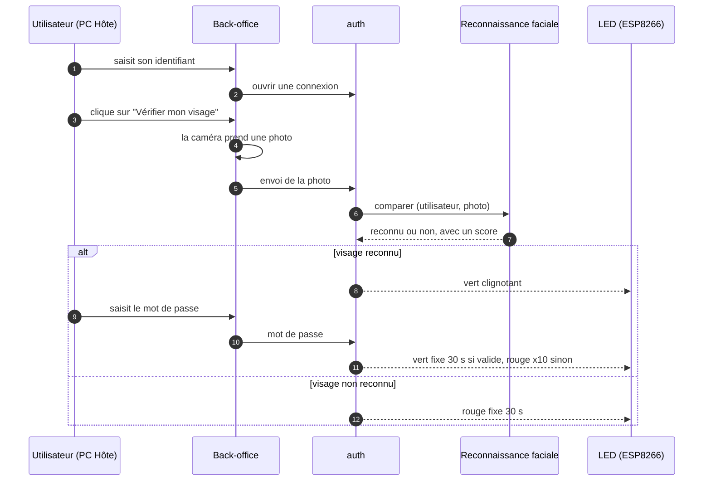
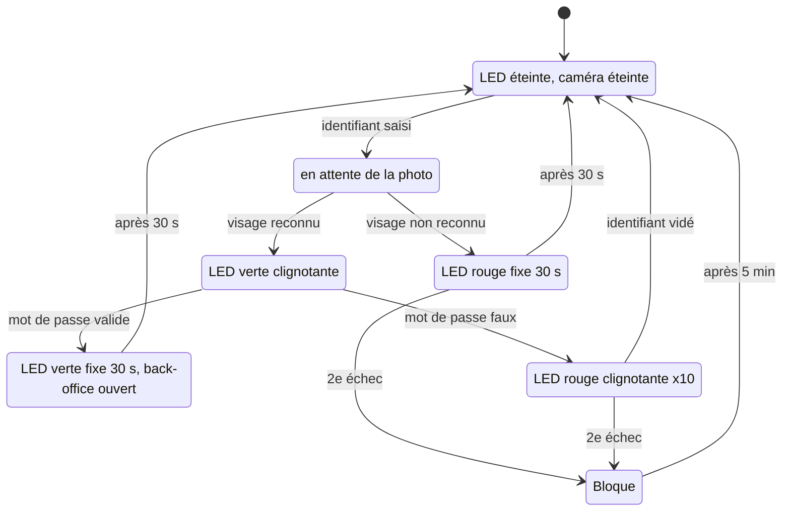

# Architecture applicative — compléments techniques

Ce document ne reprend pas ce qui est déjà dans `docs/Workshop2026-M2-G3-Dossier.pdf` (architecture générale,
flux, composants, détection et reprise, sécurité, risques, PCA/PRA, gouvernance). Il garde
uniquement le détail d'implémentation qui n'y figure pas.

## 1. Connexion du back-office

1. La personne saisit son **identifiant**.
2. Elle clique sur un bouton : la caméra prend **une photo**.
3. L'IA compare la photo au visage enregistré pour cet identifiant.
4. Si c'est le bon visage, elle peut saisir son **mot de passe**. Sinon l'identifiant est vidé et la caméra s'éteint.

`auth` est l'autorité : il garde l'état de la connexion, compte les échecs, applique le verrouillage et décide de l'état de la LED. Le service de reconnaissance faciale ne fait que comparer.

### États et LED

| État de la LED | Ce que fait la LED                      | Quand                                      |
| -------------- | ---------------------------------------- | ------------------------------------------- |
| `OFF`          | éteinte                                  | repos, ou fin d'un cycle                    |
| `GREEN_BLINK`  | verte clignotante                        | visage reconnu, en attente du mot de passe  |
| `GREEN_SOLID`  | verte fixe 30 s, puis éteinte            | mot de passe valide, back-office ouvert     |
| `RED_BLINK`    | rouge clignotante 10 fois, puis éteinte  | mot de passe refusé                         |
| `RED_SOLID`    | rouge fixe 30 s, puis éteinte            | visage non reconnu                          |

**Comment la LED est pilotée.** `auth` publie l'état sur un broker MQTT (Mosquitto), sujet `resilience/led`, avec les messages que comprend le firmware : `green-blink`, `green-solid`, `red-blink`, `red-solid`, `off`. L'ESP8266 s'y abonne et gère lui-même les durées. `auth` remet la LED à `off` à l'échéance et au démarrage du service. Pas de message conservé (`retain`) : rejouer à la reconnexion de l'ESP un état à durée limitée afficherait une LED fausse. La LED est un signal, pas une condition d'accès : si le broker est en panne, la connexion fonctionne quand même.

**Sécurité du canal.** Le broker exige un identifiant et une liste de droits : l'utilisateur `auth` peut **écrire** sur `resilience/led`, l'utilisateur de l'ESP peut seulement **lire**. Vérifié avec un vrai Mosquitto : le client anonyme est refusé, et un message envoyé par l'utilisateur de l'ESP n'est pas retransmis.

### Verrouillage

- un **échec** est un visage non reconnu ou un mot de passe refusé ;
- après **deux échecs** de suite pour un même identifiant, il est bloqué **5 minutes** ;
- chaque nouveau blocage double la durée (5, 10, 20 minutes...), avec un plafond à 1 heure ;
- une connexion réussie remet le compteur à zéro ;
- une connexion en cours expire au bout de quelques minutes si elle n'est pas terminée.

### Routes

| Route                                                             | Rôle de la route                                                                                                  |
| ------------------------------------------------------------------ | ------------------------------------------------------------------------------------------------------------------- |
| `POST /v1/backoffice/login`                                       | Ouvre une connexion à partir de l'identifiant.                                                                    |
| `POST /v1/backoffice/login/:id/face`                               | Envoie la photo (JPEG). Réponse : mot de passe attendu, ou visage refusé.                                         |
| `POST /v1/backoffice/login/:id/password`                           | Envoie le mot de passe. Réponse : jeton, ou refus.                                                                |
| `GET /v1/backoffice/login/:id`                                     | État courant, pour l'interface.                                                                                   |
| `GET /v1/devices/led`                                              | État courant de la LED (rôles `operator`, `svc:dashboard`, `admin`) : pour le dashboard et le dépannage.          |
| `GET`, `POST`, `PATCH`, `DELETE /v1/admin/users`, `PUT .../roles`  | Habilitations : comptes et rôles (rôle `admin`).                                                                  |
| `POST`, `DELETE /v1/admin/users/:id/face`                          | Enregistrement et retrait d'un visage.                                                                            |

### Sécurité spécifique

- Un compte back-office (rôle `admin`) ne peut pas se connecter par `/v1/login` : sinon on contournerait la vérification du visage.
- Un identifiant inconnu suit le même parcours et échoue à l'étape du visage : on ne révèle pas quels comptes existent.
- Les photos ne sont pas conservées. Les gabarits de visage sont des données biométriques, donc sensibles.
- Une reconnaissance sur photo peut être trompée par une photo imprimée ou affichée sur un écran (détection de « vivant » hors périmètre, limite assumée).
- Les échecs de visage, de mot de passe et les blocages sont journalisés (identifiant, IP, motif).
- Les actions d'administration sont journalisées. On ne peut pas supprimer le dernier `admin`.

## 2. Décision de la remédiation

Le moteur (`services/remediation`) applique ces règles :

- **Le score n'est pas une preuve.** La remédiation n'agit que si le score atteint un seuil (0,6 par défaut) et, pour un brute force, si assez d'échecs ont été observés (5 par défaut). Sinon l'incident est enregistré à l'état `IGNORED`, sans action.
- **Reprise = transaction de test réussie.** Le moteur vérifie que les services répondent, puis qu'un virement de test passe, en réessayant plusieurs fois. Une action ratée n'est jamais « confirmée » parce que le service répond encore.
- **IP protégées.** L'hôte et les passerelles connues ne sont jamais bloqués, même sur un signalement à score maximal.
- **IP validée strictement.** Le détecteur ne peut envoyer que de vraies adresses IPv4 ou IPv6, vérifiées à la réception puis avant l'écriture dans le WAF.
- **Blocages temporaires**, levés automatiquement même si la remédiation a redémarré entre-temps.
- **Redémarrage de la remédiation** : les incidents laissés en cours sont repris au démarrage.

## 3. Authentification et droits

- Les utilisateurs reçoivent un JWT signé en RS256, valable 15 minutes, avec le rôle `customer` (front), `operator` (dashboard) ou `admin` (back-office). Les comptes `admin` ne s'authentifient que par le parcours de connexion renforcée.
- Les services s'authentifient avec des jetons obtenus auprès de `auth` : `svc:detector`, `svc:dashboard`, `svc:remediation`.
- Seul `svc:detector` peut créer un incident. Seuls `operator` et `svc:dashboard` peuvent les consulter.
- Seul le compte de service dédié à la transaction de test peut l'envoyer (en-tête `X-Synthetic`).

## 4. Choix techniques

- **Services** : Node.js 22, Express 5, TypeScript. `zod` pour valider les entrées, `pino` pour les logs JSON, `prom-client` pour `/metrics`, `jose` pour les JWT.
- **Données** : PostgreSQL 16 et Prisma, un schéma Prisma par service. Les montants sont des entiers en centimes, et un virement s'exécute dans une transaction pour éviter les soldes incohérents.
- **Front, dashboard et back-office** : trois applications React avec TypeScript, Vite et Tailwind, séparées parce que leur public et leurs droits diffèrent.
- **Docker** : `dockerode` pour parler au proxy Docker filtré. Images en `node:22-slim` (Prisma se comporte mal sur Alpine).
- **Tests** : Vitest et Supertest, plus un test de bout en bout de la transaction de test.

## 5. Contrats d'API

Chaque service décrit ses routes dans un fichier OpenAPI 3.1, REST et JSON :

| Service       | Fichier                                                        |
| ------------- | ---------------------------------------------------------------- |
| auth          | [`api/auth.openapi.yaml`](api/auth.openapi.yaml)               |
| api paiements | [`api/payments.openapi.yaml`](api/payments.openapi.yaml)       |
| remédiation   | [`api/remediation.openapi.yaml`](api/remediation.openapi.yaml) |

Conventions communes : routes sous `/v1`, erreurs au format `application/problem+json`, en-tête `X-Request-Id` propagé, dates en UTC ISO 8601, montants en centimes.
